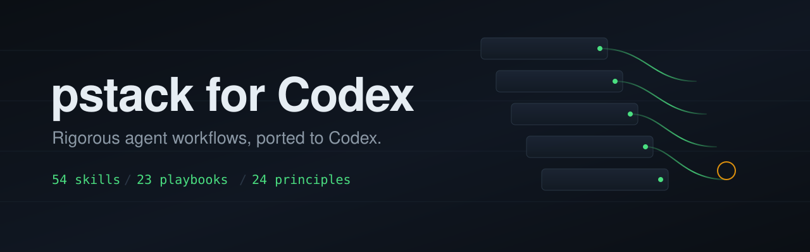

# pstack for Codex

[](https://github.com/lengjingxu/pstack-for-codex/actions/workflows/validate.yml)
[](https://github.com/lengjingxu/pstack-for-codex/stargazers)
[](LICENSE)
[](https://github.com/lengjingxu/pstack-for-codex/commits/main)
[](https://github.com/lengjingxu/pstack-for-codex/releases)


**pstack for Codex** 是 [pstack](https://github.com/cursor/plugins/tree/main/pstack)（作者 Lauren Tan）的 Codex 移植版。同一套工作方法，同一批 playbook，同一批原则，只把运行宿主从 Cursor 换成 Codex。

[English](README.md) | [Français](README.fr.md) | [日本語](README.ja.md) | [한국어](README.ko.md)

> **一句话**：55 个技能，23 个 playbook，24 条原则，一个负责路由的技能。给想在 Codex 里做“有计划、有验证、有证据”的工程工作的用户。早期版本，没有遥测。用过之后，欢迎告诉我们哪里变了。

## 为什么有这个 Codex 移植

上游 pstack 为 Cursor 而写，后来官方加了 Claude Code 适配。在 [PR #637](https://github.com/cursor/plugins/pull/637) 里，维护者加入 Claude Code 支持，并明确删掉了 Codex 适配（[commit e84046f](https://github.com/cursor/plugins/commit/e84046f96b857f4070355e491cfc4bc7759c2ba6)）。Codex 用户留下了方法，却没有对应的接线。

这个仓库保留作者的方法，把 Cursor 专有的部分映射到 Codex 原语：`spawn_agent`、`$CODEX_HOME/skills`、Codex 会话日志、`ask_user_question`，以及显式调用 `$poteto-mode`。Codex 没有对应能力的地方，技能会直接说明并继续，不会偷偷换成一个改变方法的替代品。

## 里面有什么

**本次同步**：上游在 [commit 4382e68](https://github.com/cursor/plugins/commit/4382e687a50b8d2c5ce4d141d001186589cff8d5) 新增了 `/create-formal-verification-skill`，这里已移植为 `$create-formal-verification-skill`：为项目生成一个本地技能，针对“测试很难覆盖、但出错代价最高”的那处代码做一次形式化验证；工具不预设，按问题选模型检查器、SMT 求解器或证明助手。

| 项目 | 数量 |
| --- | ---: |
| 技能 | 55 |
| Playbook | 23 |
| 原则 | 24 |
| 路由技能 | 1（`$poteto-mode`） |
| 子代理提示词 | 2 |
| 语言 | EN、简体中文、FR、JA、KO |

## 适合谁

- 想在 Codex 里用一套可重复的工程工作流，而不是一个 prompt 包的人。
- 在意运行证据、评审面板和“没跑过就不算完成”的团队。
- 把 pstack 移植到其他宿主、需要一份可运行参考的人。

不适合：只想看模型跑分，或想要零配置全自动的人。pstack 是工作流层，活还是模型干。

## 早期采用与证据

截至 **2026-10-19**（仓库创建于 2026-10-16）：

| 信号 | 数值 |
| --- | ---: |
| GitHub 流量，14 天窗口 | 24 个唯一克隆者 / 41 次克隆 |
| Star / Fork / 开放 Issue | 0 / 0 / 0 |
| Release | 1 个（`v1.0.0`） |
| Commit / 贡献者 | 4 / 1 |

怎么读这些数字：

- **克隆是采用信号，不是活跃用户数。** CI、镜像、重复克隆都会把它抬高。仓库没有遥测，也不会回传数据。
- **目前没有公开的效果或基准数据，我们不会编一个。** 如果你在真实任务上用了 pstack for Codex，欢迎提交 [usage report](https://github.com/lengjingxu/pstack-for-codex/issues/new/choose)，附上任务、宿主和前后对比证据。

方法和更新记录：[docs/ADOPTION.md](docs/ADOPTION.md)。

## 怎么判断效果

pstack 不承诺一个基准分数。它改变的是工作流：把任务路由到 playbook，要求运行证据，验证通过才叫完成。要在自己的仓库里评估，建议用同一个任务做对照：

- 返工次数（agent 从头重来的次数）
- 验证失败次数
- 评审意见和后续修复
- 从开始到合并的时间
- diff 大小 / 改动文件数

把结果提交到 usage report；经你同意后，我们会把它加进采用记录。

## 社区引用

这些链接用来解释“为什么要有 Codex 移植”，以及这套方法正在被怎么采用。它们是背景，不代表这些项目为本仓库背书。

- **上游 pstack**：[cursor/plugins](https://github.com/cursor/plugins) —— 12,648 star、1,241 fork（2026-10-19）。这是包含 pstack 的仓库，不是本移植版。
- **Codex 适配被删除**：[PR #637](https://github.com/cursor/plugins/pull/637) 加入 Claude Code 支持；[commit e84046f](https://github.com/cursor/plugins/commit/e84046f96b857f4070355e491cfc4bc7759c2ba6) 删除了 Codex 适配。
- **社区讨论**：[V2EX：今天，PStack 官方支持 Claude Code 了，但是没支持 Codex](https://www.v2ex.com/t/1249647)（2026-10-17）。
- **作者**：Lauren Tan（[@poteto](https://x.com/poteto)）；V2EX 译文引用了她的 X 帖 [“Coding is dead, long live Coding”](https://x.com/poteto/status/2103571281014861957)。
- **其他宿主移植**：[pstack-codex](https://github.com/ScriptedAlchemy/pstack-codex)、[pstack-muse](https://github.com/jnyross/pstack-muse)、[pstack-vscode](https://github.com/hackernotfound/pstack-vscode)、[opencode-pstack](https://www.npmjs.com/package/@falentio/opencode-pstack)。不同宿主，同一套方法；不代表它们为本仓库背书。
- **关于本移植版的 X 讨论**：截至 2026-10-19，没有检索到公开帖子。上面的 X 链接是上游背景；如果你发了相关帖子，开一个 issue，我们会补上链接。

## 立场

技能应当能换宿主。

上游 pstack 明确说明它为 Cursor 而写，并且依赖只有 Cursor 才有的机制：带角色模型 slug 的 Task 工具、Custom Mode、`/loop`、内置 `create-skill`、`cursor-team-kit` 辅助技能，以及 `~/.cursor/rules` 下的规则。

这次移植不改作者的方法。playbook、原则、多模型评审、文字纪律，以及“没有运行证据就不算完成”这条底线，都按原样保留。只替换 Codex 上不存在的那部分。

本仓库遵守一条规则：能在 Codex 找到对应原语的，就做映射；找不到的，就明说并继续，绝不用一个会悄悄改变方法的替代品来充数。

## 改了什么

| 上游（Cursor） | 这里（Codex） |
| :--- | :--- |
| `Task` 工具、`subagent_type` | `spawn_agent` |
| `~/.cursor/rules/pstack-models.mdc` | `~/.codex/pstack-models.md` |
| 模型 slug `claude-opus-5-5-xhigh`、`grok-4.7-xhigh-fast` | `gpt-6-astra`、`gpt-6.1-sol` |
| `~/.cursor/projects/` 下的 `agent-transcripts/` | `$CODEX_HOME/sessions/<YYYY>/<MM>/<DD>/rollout-*.jsonl` |
| `.cursor/skills/` | `.agents/skills/` |
| Cursor 内置 `create-skill` | `skill-creator` 技能 |
| `AskQuestion` | `ask_user_question` |
| `/loop` | 定时任务或监听子代理 |
| Custom Mode | Codex 没有，按任务调用 `$poteto-mode` |
| `disable-model-invocation: true` | `policy.allow_implicit_invocation: false` |
| `cursor-team-kit` 的 `deslop`、`control-cli`、`control-ui` | shell 执行、浏览器与电脑操作 |
| `Make Bot UI` 的 routine webhook | Codex 上不可用，仅作文档 |

## 安装

快速安装：

```bash
git clone --depth 1 https://github.com/lengjingxu/pstack-for-codex.git /tmp/pstack-for-codex
bash /tmp/pstack-for-codex/scripts/install.sh
```

或手动复制：

```bash
git clone https://github.com/lengjingxu/pstack-for-codex.git /tmp/pstack-for-codex

mkdir -p "$CODEX_HOME/skills/pstack/agents"
cp -R /tmp/pstack-for-codex/skills/. "$CODEX_HOME/skills/pstack/"
cp /tmp/pstack-for-codex/agents/*.md "$CODEX_HOME/skills/pstack/agents/"
```

Codex 会自动发现新技能。如果没有出现，重启 Codex。

## 使用

1. `$setup-pstack`：选择推理档位并为每个角色指定模型，写入 `~/.codex/pstack-models.md`。
2. `$poteto-mode <任务>`：把任务匹配到某个 playbook，将其步骤复制进待办列表，并按需调用其他技能。
3. `$poteto-help`：不确定该用哪个技能时用它。

除 `setup-pstack` 外，所有技能都只在显式调用时生效，所以装 55 个技能不会撑爆技能列表的上下文预算。

## 与上游不同的命名

- `tdd` 改为 `pstack-tdd`
- `teach` 改为 `pstack-teach`

原因是常见的 Codex 环境里已存在同名技能，而 Codex 不会合并同名技能。

## 已知限制

- `make-bot-ui` 依赖 Cursor 的 routine webhook。在 Codex 上只描述结构，并在文中说明。
- `deslop`、`control-cli`、`control-ui` 属于 Cursor 的 `cursor-team-kit` 插件，这里没有。用到它们的步骤会说明并继续。
- 角色模型使用 Codex 的模型 slug，请运行 `$setup-pstack` 指向你实际可用的模型。
- 读取会话记录的部分按 `$CODEX_HOME/sessions` 的路径。

## 自己验证

1. 安装 pstack for Codex，运行 `$setup-pstack`。
2. 选一个你已经知道怎么判断好坏的任务。
3. 不用 pstack 跑一次，再用 `$poteto-mode` 跑一次。
4. 对比上面五个信号：返工、验证失败、评审意见、合并时间、diff 大小。

把结果提交到 [usage report](https://github.com/lengjingxu/pstack-for-codex/issues/new/choose)，附上 Codex 版本和宿主。

## 目录结构

```
skills/                 55 个技能，每个含 SKILL.md 与 agents/openai.yaml
  poteto-mode/          路由模式、23 个 playbook 及其脚本
  principle-*/          24 条原则，按叶子技能读取
  setup-pstack/         角色模型与推理档位
agents/                 交给 spawn_agent 的两个子代理提示词
docs/guide/             上游指南，已适配
```

## 致谢

pstack 由 [Lauren Tan](https://x.com/poteto) 创作，位于 [cursor/plugins](https://github.com/cursor/plugins)。方法、playbook、原则与文字都出自她。本仓库是移植，不是改主张：只改宿主接线，不动思考方式。

MIT 许可，与上游一致。见 [LICENSE](LICENSE) 与 [THIRD_PARTY_NOTICES.md](THIRD_PARTY_NOTICES.md)。

## 如果有用

一个 star 能帮其他 Codex 用户找到它。欢迎 issue、其他宿主移植和 usage report。如果 pstack for Codex 改变了你的 agent 工作方式，告诉我们具体变了什么——这是这个项目最需要的证据。

## 语言

- [English](README.md)
- [简体中文](README.zh-CN.md)
- [Français](README.fr.md)
- [日本語](README.ja.md)
- [한국어](README.ko.md)
